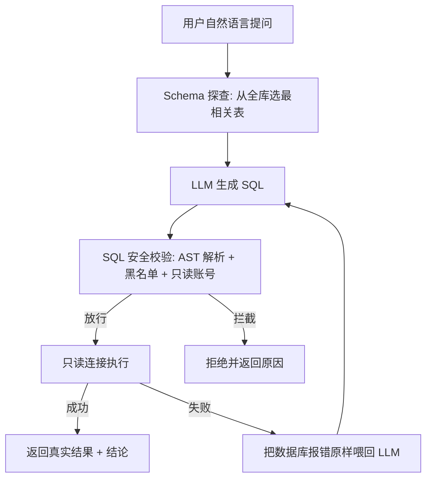

# SQLPilot

> 用自然语言问数据库 —— 一个能自己选表、自己写 SQL、写错了自己改的查询 Agent。

🌐 **在线 Demo（公网可访问）**：[https://jiangbianwangui-sqlpilot-light.ms.show](https://jiangbianwangui-sqlpilot-light.ms.show) —— 双 Tab：单步 text-to-SQL + 多步数据分析 Agent（默认演示模式，无需 Key 即可体验完整闭环）。

## 📝 项目简介

SQLPilot 是一个 **text-to-SQL 智能体**：你用大白话提问（如"北京客户一共花了多少钱"），它自己决定该看哪些表、自己写出 SQL、在**只读连接**上执行，如果 SQL 写错了（字段名幻觉、语法笔误、聚合写错），它把数据库的报错原样喂回大模型，让模型自己改，直到跑出结果。

它解决的真实问题是：**让不懂 SQL 的人也能从业务库里取数，同时不让大模型碰坏数据库**。

项目围绕三条主线设计：

- **安全**：LLM 生成的 SQL 不可信，绝不能拿到连接直接执行。
- **闭环**：Agent 的价值不在于"一次写对"，而在于"错了能改"。
- **可测**：每一层职责单一、依赖可注入，单测不需要真数据库、也不需要真 API。

## ✨ 核心功能

- [x] **自然语言转 SQL**：一句话提问，自动产出可执行的 SELECT 查询
- [x] **智能选表**：从几十上百张表里挑出最相关的几张喂给大模型，避免上下文撑爆、选错表
- [x] **错误自修复**：执行失败 → 把数据库报错喂回大模型 → 自动重写，最多重试 3 次
- [x] **三层安全校验**：AST 解析 + 关键词黑名单 + 只读账号，挡住 DROP / 注入 / 堆叠查询
- [x] **只读执行**：强制 LIMIT 防内存爆，错误信息归一化为中文便于模型修正
- [x] **慢查询诊断（差异化功能）**：用数据库自带的 `EXPLAIN` 分析执行计划，检测全表扫描并建议建索引
- [x] **多方言驱动**：同一套逻辑可跑 SQLite 内存库与真实 MySQL，诊断层按 `engine.dialect.name` 自动切换 `EXPLAIN` 语法
- [x] **零 Docker 一键 Demo**：SQLite 内存库即可跑通整条链路
- [x] **多步数据分析 Agent（升级）**：`DataAnalysisAgent` 以 ReAct 风格的工具调用循环工作——自己决定何时查表结构、跑 SQL、诊断、出图，并维护会话记忆支持多轮追问与反思重规划

## 🏗️ 架构与闭环

SQLPilot 不是"调一次 LLM 出 SQL"，而是一个**带真实执行反馈的闭环**。以单步 `SQLAgent` 为例：



- **单步闭环（`SQLAgent`）**：生成 → 校验 → 执行 →（失败则带报错重写，最多 3 次）→ 返回真实数据。
- **多步 Agent（`DataAnalysisAgent`）**：在单步之上叠加 ReAct 工具循环（`inspect_schema` / `run_sql` / `diagnose` / `plot`）+ 会话记忆 + 反思重规划，支持多轮追问。

闭环的关键是"执行结果"成了 LLM 的下一步输入，而不是由人充当执行器与校验器——这正是它相对"一次性 prompt"的核心区别。

## ❓ 为什么不直接问 ChatGPT？

直接把问题丢给通用 AI，它只会**吐出一段 SQL 文本就结束**——跑不跑得通、表名/字段是不是编的，它不知道，还得你自己复制去库里跑、报错再贴回去。SQLPilot 把"生成 → 执行 → 观察 → 修正"闭环自动化：

| 维度 | 直接问 AI（开环） | SQLPilot（闭环） |
| --- | --- | --- |
| 结果可信度 | 文本生成，表名/字段可能 hallucinate | 先读真实 schema，再执行真实库，结果是跑出来的 |
| 出错处理 | 你手动把报错贴回去，来回拉扯 | `diagnose` 自动抓报错、分析、重写 SQL |
| 多步分析 | 单轮问答，上下文需手动搬运 | `DataAnalysisAgent` + 会话记忆，跨轮追问 |
| 数据安全 | 等于把库结构外发给第三方 | 可跑私有库，schema 不必出域（支持本地 LLM） |
| 工程化 | 无边界、不可复现 | 85 单测 + 参数校验 + 多级降级，可审计 |

**面试一句话话术**：
> "LLM 直接生成 SQL 是开环、未验证的，表名都可能编。我做的 SQLPilot 把『生成→执行→观察→修正』闭环自动化，用真实 schema 约束 + 执行反馈自愈，保证输出是能跑通、结果可信的。这正是 text-to-SQL Agent 相比『直接问 AI』的核心价值。"

## 🛠️ 技术栈

- **智能体范式**：单 Agent 闭环（`SQLAgent`，生成 → 执行 → 反馈 → 重写）+ 多步工具调用 Agent（`DataAnalysisAgent`，ReAct 风格，会话记忆 + 反思重规划）。Agent 循环为**自实现**，不依赖外部 Agent 框架（早期参考过 Hello-Agents 教程思路，但代码已独立重写）
- **LLM 接口**：OpenAI 兼容 chat + tool-calling（`DeepSeekLLM.chat`），支持 DeepSeek / 硅基流动 / 通义千问
- **SQL 解析 / 安全**：`sqlglot`（AST 解析）、正则兜底
- **数据库访问**：`SQLAlchemy 2.x` + `PyMySQL`，SQLite 与 MySQL 双方言实测通过（正式环境为 MySQL 只读账号）
- **大模型**：DeepSeek（OpenAI 兼容接口），通过环境变量可切换 Ollama / 通义等
- **工程**：`pytest`（85 个用例）、`loguru` 日志
- **设计取舍**：刻意不引入 `torch` / `transformers`，全部推理走 LLM API，环境轻、启动快

## 🚀 快速开始

### 环境要求

- Python 3.10+（已在 3.13 验证）
- 一个 OpenAI 兼容的大模型 API Key（默认 DeepSeek）

### 安装依赖

```bash
# 官方源偶发不可用，推荐阿里云镜像
pip install -i https://mirrors.aliyun.com/pypi/simple -r requirements.txt
```

### 配置 API 密钥

在项目根目录创建 `.env` 文件：

```ini
LLM_API_KEY=sk-你的key
LLM_BASE_URL=https://api.deepseek.com
LLM_MODEL_ID=deepseek-chat
```

### 运行 Demo

无需 MySQL / Docker，用 SQLite 内存库即可跑通整条链路：

```bash
python -m app.demo "北京客户一共花了多少钱"

# 多步数据分析 Agent（工具调用 + 会话记忆 + 反思重规划）
python -m app.demo_agent "各城市各有多少客户？"
# 不带参数进入多轮对话 REPL（可连续追问）
python -m app.demo_agent
```

> 也可以直连真实数据库：`app/demo.py` 里的 `build_mysql_engine()` 连一个 **MySQL 只读账号**，
> 诊断工具会自动按方言切换 `EXPLAIN` 语法，`SQLAgent` 上层代码一行都不用改。

## 🌐 Web 服务与公网部署

除了命令行，SQLPilot 提供两种可公网访问的服务形态：

### 方式一：FastAPI HTTP 服务（含极简聊天前端）

```bash
# 本地启动（默认 7860 端口），浏览器打开 http://127.0.0.1:7860
uvicorn app.server:app --host 0.0.0.0 --port 7860

# 无 LLM Key 也能跑通闭环（演示/离线用）
SQLPILOT_FAKE_LLM=1 uvicorn app.server:app --port 7860
```

接口：

| 方法 | 路径 | 说明 |
| --- | --- | --- |
| GET | `/api/health` | 健康检查 |
| GET | `/api/ask?question=...` | 单步 `SQLAgent`：返回生成 SQL + 结果 + 重试过程 |
| POST | `/api/agent` | 多步 `DataAnalysisAgent`：`{question, session_id}` → 含工具调用轨迹 |
| POST | `/api/reset` | 清空某会话记忆 |
| GET | `/` | 极简聊天前端 |

### 方式二：Gradio 双 Tab 演示（推荐用于公网 Demo）

`app.py` 把单步 text-to-SQL 与多步数据分析 Agent 包装成两个 Tab，复用 `app.server` 已初始化的引擎与 LLM 注入，自带会话记忆：

```bash
pip install -r requirements.txt
SQLPILOT_FAKE_LLM=1 python app.py   # 浏览器打开 http://127.0.0.1:7860
```

演示库默认用**文件型 SQLite**（自带 shop 示例数据），无需外部数据库；大模型读 `LLM_API_KEY` / `LLM_BASE_URL` / `LLM_MODEL_ID` 三个环境变量。生产环境把 `build_demo_engine()` 换成 `build_mysql_engine()`（**只读账号**）即可。

### 本地用真实 LLM 运行（推荐）

公网 Demo 出于**额度与安全**考虑默认跑演示模式（`SQLPILOT_FAKE_LLM=1`，不消耗任何 API 额度、不暴露 Key）。想体验真实推理，**在你自己电脑上**接一个真 LLM 即可——代码无需改动，全靠环境变量驱动：

```bash
# 1) 复制环境变量模板，填入你自己的 Key
cp .env.example .env          # Windows cmd 用：copy .env.example .env
#   编辑 .env：LLM_API_KEY=sk-xxx，LLM_BASE_URL / LLM_MODEL_ID 按服务商填

# 2) 不设 SQLPILOT_FAKE_LLM（或设为 0），即为真实 LLM 模式
python app.py                 # 浏览器打开 http://127.0.0.1:7860
# 或 FastAPI 形态：uvicorn app.server:app --port 7860
```

推荐服务商 **硅基流动 SiliconFlow**（国内、注册送额度、便宜，OpenAI 兼容）：

| 变量 | 值 |
| --- | --- |
| `LLM_BASE_URL` | `https://api.siliconflow.cn/v1` |
| `LLM_MODEL_ID` | `Qwen/Qwen2.5-7B-Instruct`（或 `deepseek-ai/DeepSeek-V3` 等） |
| `LLM_API_KEY` | 你在硅基流动控制台申请的 Key |

> 任何 OpenAI 兼容端点都能用（DeepSeek、通义 DashScope 兼容模式、本地 Ollama、vLLM…），只换上面三个变量。`.env` 已被 `.gitignore` 忽略，**不会提交**，可放心填 Key。

### 容器化 / 平台部署

- **魔搭 ModelScope 创空间**：走 `Gradio` 类型，配置见 `ms_deploy.json`（`sdk_type: gradio`，官方免费档 `platform/2v-cpu-8g-mem`，端口 7860）。入口为 `app.py`。
- **本地 Docker / Hugging Face Spaces**：见仓库根目录 `Dockerfile`（FastAPI 镜像，非 root 运行），本地构建命令：
  ```bash
  docker build --build-arg BASE_IMAGE=docker.m.daocloud.io/library/python:3.11-slim -t sqlpilot:local .
  docker run --rm -p 7860:7860 sqlpilot:local
  ```
  > 注：魔搭的「Docker 类型」在当前账号/平台下不可用（构建节点拉不到外部 registry 镜像），故魔搭改走 Gradio 类型。

## 📖 使用示例

**代码调用**（demo 引擎，可换成任意 SQLAlchemy 引擎）：

```python
from app.demo import build_demo_engine
from app.core.llm import llm_generate
from app.agents.sql_agent import SQLAgent

agent = SQLAgent(build_demo_engine(), llm_generate=llm_generate)
answer = agent.ask("北京客户一共花了多少钱")
print(answer.render())
```

**慢查询诊断**（不依赖大模型，可直接跑）：

```python
from app.demo import build_demo_engine
from app.tools.diagnose_tool import DiagnoseTool, render

tool = DiagnoseTool(build_demo_engine())
print(render(tool.diagnose("SELECT * FROM products WHERE name='智能手机 X1'")))
```

真实输出：

```
SQL: SELECT * FROM products WHERE name='智能手机 X1'
执行计划:
  SCAN products
检测到全表扫描: products
建议:
  - 建议为products表的相关字段建索引
```

同一个工具连 MySQL 时，会自动改用 MySQL 的 `EXPLAIN`，按 `type='ALL'` 且无命中索引判定全表扫描（SQLite 走 `EXPLAIN QUERY PLAN`，解析文本行）—— 调用方代码完全一致。

主问答的返回结构（`Answer.render()` 格式）包含：选中的表、每次尝试的 SQL 与成败、最终结果、耗时——方便演示"第一次写错、第二次改对"的闭环过程。

## 🎯 项目亮点

- **安全分层，而非仅靠黑名单**：先用 `sqlglot` 把 SQL 解析成 AST，只放行 SELECT/UNION/WITH；再做关键词黑名单兜底；最后靠数据库**只读账号**兜底。注释会在检查前剥离，避免 `-- DROP TABLE` 这类藏匿手段，也避免把 `created_at` 里的 `ate` 误判成危险词。
- **错误自修复闭环**：这是 Agent 相对"一次性 prompt"的核心价值——把数据库真实报错原样喂回模型重写，而不是直接把错误抛给用户。
- **多道防线，绝不裸奔**：`sqlglot` 缺失时降级为正则；给查询补 LIMIT 失败时退回原句；执行异常归一化为中文。任何一层出问题都不会让整个服务崩。
- **引擎无关 + 职责分离**：schema 探查用 SQLAlchemy `inspector`，MySQL / SQLite / PostgreSQL 通用；诊断层按方言适配 `EXPLAIN`；LLM 与执行器都以"可调用对象"注入，单测用假函数即可覆盖完整重试逻辑。
- **中文友好**：错误信息是可读的中文，能直接作为下一轮 prompt 的一部分，让模型自我修正。

## 🤖 多步数据分析 Agent（DataAnalysisAgent）

在 `SQLAgent` 单步闭环之上，`DataAnalysisAgent` 把"取数"升级成真正的对话式数据分析：

- **工具调用（Tool Calling）**：模型自己决定何时 `inspect_schema` 看结构、`run_sql` 取数、`diagnose` 诊断慢查询、`plot` 出图，而不是写死流水线与工具顺序。
- **会话记忆（Memory）**：跨轮保留上下文，支持追问（"那上海呢？""只看今年呢？"）。
- **反思-重规划（Reflection）**：拿到执行结果后，模型自己判断继续、换 SQL、澄清歧义还是收尾——这是 Agent 相对"一把函数"的核心价值。
- **安全不打折**：`run_sql` 底层复用 `ExecuteTool`，三层校验 + 只读账号 + 强制 LIMIT 全部生效，模型写 DROP 也会被拦。

```python
from app.demo import build_demo_engine
from app.core.llm import llm_chat
from app.agents.data_agent import DataAnalysisAgent

agent = DataAnalysisAgent(build_demo_engine(), llm_chat=llm_chat)
reply = agent.run("各城市各有多少客户？")
print(reply.render())   # 含推理过程与最终回答
```

## 📊 性能评估

本项目没有做生产级压测（演示库为 SQLite 内存小库），因此本节**只讲架构层面的取舍，不列未经实测的延迟 / QPS 数字**。

- **安全不靠运气**：三层校验 + 只读账号，从"代码层"和"数据库层"两道关防住注入，而不是依赖关键词黑名单（最易被绕过）。
- **不崩比快更重要**：多级降级保证单点故障不影响整体，错误归一化让模型能继续自我修复。
- **轻量低成本**：全部推理走 LLM API，不加载重模型；强制 LIMIT 防止超大结果集拖垮内存；`EXPLAIN` 诊断基于数据库原生能力，几乎零额外开销。
- **可测即可靠**：依赖注入使 85 个单元测试无需真 API 即可秒级跑完（MySQL 方言用例在无 MySQL 的环境自动跳过），CI 友好。

## 🔮 未来计划

- [ ] **选表升级为向量召回 + 外键图扩展**：当前用规则打分（2-gram + 注释匹配），不理解"北京客户花了多少钱"里的隐含 JOIN 关系，已预留 `select_tables` 接口
- [x] **支持多轮对话与上下文记忆**：`DataAnalysisAgent` 的 `Memory` 跨轮保留上下文，支持追问（"那上海呢？""只看今年呢？"）
- [ ] **诊断升级**：补齐 PostgreSQL 方言（`EXPLAIN (ANALYZE, BUFFERS)`），并覆盖复合索引、JOIN 顺序等更细的执行计划建议
- [ ] **方言抽象层**：把当前 `if dialect == ...` 的分支抽成 `Dialect` 接口，新增数据库时只加一个实现类

## 🤝 贡献指南

欢迎提出 Issue 和 Pull Request！提交前请确保：

- `pytest` 全部通过
- 新增功能附带测试
- 安全相关改动同步更新 `tests/test_sql_guard.py`

## 📄 许可证

CC BY-NC-SA 4.0。本项目在学习 Datawhale **Hello-Agents** 教程（同许可）的基础上由作者独立实现，
原创代码版权归作者所有；如引用本仓库，请保留原作者署名并注明改编部分。

## 👤 作者

- GitHub：[@jiangbianwangui](https://github.com/jiangbianwangui)
- 提交到 Hello-Agents 共创仓库时，目录名为 `jiangbianwangui-SQLPilot`，PR 标题：`[毕业设计] SQLPilot - 自然语言转 SQL 的数据库查询 Agent`

## 🙏 致谢

- [Datawhale](https://github.com/datawhalechina) 与 [Hello-Agents](https://github.com/datawhalechina/hello-agents) 教程提供的框架与选题指引
- 社区 `DatabaseAgent` 等实现带来的对比与启发
